Previously Software Engineer at <a href="https://vivasoftltd.com/">Vivasoft</a>

## Open source

Hero counts refresh daily from GitHub. PR badges update live.

### ⭐ Featured PRs

<table>
<tr>
<td width="33%" valign="top">
&nbsp;<b><a href="https://github.com/microsoft/agent-framework">agent-framework</a></b>&nbsp; 
Microsoft's agent SDK · Python
  
3 merged fixes to model clients. A boto3 session set to <code>eu-west-1</code> was sent to <code>us-east-1</code> with no error. Mistral and Gemini now respect an injected SDK client.
  
  
</td>
<td width="33%" valign="top">
&nbsp;<b><a href="https://github.com/vercel/next.js">next.js</a></b>&nbsp; 
Vercel's React framework · TypeScript
  
App Router-only builds returned 500 for client errors Next.js raised itself, such as a bad param or a bad <code>Range</code>. They now keep the 4xx status.
  

</td>
<td width="33%" valign="top">
&nbsp;<b><a href="https://github.com/openclaw/openclaw">openclaw</a></b>&nbsp; 
AI assistant · 390K+ stars · TypeScript
  
4 fixes across IRC, LINE, formatting and the dashboard. A fallback IRC nick grew past the 30-character limit. Sizes like "1024 KiB" now roll over to "1.0 MiB".
  
   
</td>
</tr>
<tr>
<td width="33%" valign="top">
&nbsp;<b><a href="https://github.com/JetBrains/thinkrail">thinkrail</a></b>&nbsp; 
JetBrains' agentic IDE · TypeScript · WSL
  
Editor lookup scanned a slow WSL <code>PATH</code> on the event loop and froze the host for seconds. "Reveal in file manager" opened a hidden Explorer window on Windows.
  
 
</td>
<td width="33%" valign="top">
&nbsp;<b><a href="https://github.com/Nano-Collective/nanocoder">nanocoder</a></b>&nbsp; 
Open coding agent · TypeScript
  
2 merged fixes: MCP tool results kept only the first content block, and <code>string_replace</code> missed matches in CRLF files. Also an XSS fix in the VS Code webview.
  
  
</td>
<td width="33%" valign="top">
&nbsp;<b><a href="https://github.com/HKUDS/DeepTutor">DeepTutor</a></b>&nbsp; 
AI tutor · Python · LLMs
  
3 merged LLM fixes. Reasoning-model replies broke lesson JSON. Strict gateways rejected replayed items. Long Claude Code prompts failed on Windows.
  
  
</td>
</tr>
</table>

### 📂 All contributions

<b>🤖 AI agents & LLM frameworks · agent-framework, openclaw, DeepTutor, crewAI, pydantic-ai, LangChain, open-notebook</b>

 

| Project | What I fixed | PR |
|:--|:--|:--|
| [**microsoft/agent-framework**](https://github.com/microsoft/agent-framework)      `Python` `boto3` `Gemini SDK` `pytest` | **Bedrock:** a boto3 session set to `eu-west-1` was sent to `us-east-1` when `BEDROCK_REGION` said so. No error was raised. The session's region now wins. |  |
| | **Mistral:** `service_url` now reports the endpoint of the injected SDK client, not the default URL. |  |
| | **Gemini:** with an injected `genai.Client`, a bad env value such as `GOOGLE_GENAI_USE_ENTERPRISE` still crashed construction. Those settings are now skipped. |  |
| | **Foundry hosting:** cumulative usage snapshots were added together, so 100 then 250 input tokens showed as 350. Each agent's snapshot now replaces only that agent's usage. |  |
| [**openclaw/openclaw**](https://github.com/openclaw/openclaw)      `TypeScript` `Node.js` `Vitest` | **IRC:** after repeated nick collisions the fallback nick grew past the 30-character limit. It is now cut to fit. |  |
|  | **Formatting:** sizes just below a unit boundary showed as "1024 KiB". They now roll over to "1.0 MiB". |  |
|  | **LINE:** email links in table cells showed twice, as `addr (mailto:addr)`. They now show once. |  |
|  | **Dashboard:** author search bolded the wrong letters for Korean and accented names. Highlights now match the typed text. |  |
| [**HKUDS/DeepTutor**](https://github.com/HKUDS/DeepTutor)      `Python` `LLMs` | Lesson prep broke on reasoning models when `<think>` blocks or prose wrapped the JSON. It now finds the JSON and retries once at the right effort level. |  |
|  | **Responses API:** strict gateways rejected `status` on replayed items such as `function_call`. It is now stripped from every item. |  |
|  | **Workspace:** a failed probe-file delete escaped the request. Cleanup is now best effort. |  |
|  | **Claude Code:** system prompts over 32K characters failed on Windows with a misleading "not found" error. Long prompts now go through a file. |  |
| [**crewAIInc/crewAI**](https://github.com/crewAIInc/crewAI)      `Python` `pytest` | **Files:** expired-upload cleanup never called the provider's delete, because the lookup had already dropped expired entries. Expired files are now deleted. |  |
|  | **Telemetry:** strings, numbers and `None` at the depth limit became `repr()` strings. Primitives are now kept unchanged. |  |
|  | **A2A auth:** a comma inside a quoted `WWW-Authenticate` value split the challenge. Parsing now respects quotes and escapes. |  |
|  | **Planning:** replanned steps restarted at 1 and clashed with completed steps. Clashing steps are now renumbered. |  |
|  | **CLI:** after an upgrade, a cached yanked flag from the old version showed a false warning. The cache is now tied to the installed version. |  |
|  | **Executor:** every batch after a replan asked for another replan over failures already handled. Handled failures are now skipped. |  |
| [**pydantic/pydantic-ai**](https://github.com/pydantic/pydantic-ai)      `Python` `asyncio` `SQLite` `pytest` | **OpenAI batch:** grouping read `default_headers`, which ran `uname -p` on the event loop. It now hashes only the auth, org and project headers. |  |
|  | **Tests:** the Mistral `max_retries` test made one attempt on slow runners. It now uses a fake clock, so it passes at any speed. |  |
|  | **Planning:** `SqlitePlanStore` leaked its connection when schema setup failed on a locked database. It now closes and re-raises. |  |
| [**calesthio/OpenMontage**](https://github.com/calesthio/OpenMontage)      `Python` `ComfyUI` `FFmpeg` | The ComfyUI video tool reported request defaults as output metadata. It now reports the real values probed from the file. |  |
| [**tryAGI/LangChain**](https://github.com/tryAGI/LangChain)      `C#` `.NET` `RAG` | `AddDocumentsFrom*` helpers now take several data sources in one call for RAG ingestion. |  |
| [**lfnovo/open-notebook**](https://github.com/lfnovo/open-notebook)      `Python` `SurrealDB` | **Sources:** a delete that hit a SurrealDB conflict returned 200, but the source and its chunks stayed. Errors now raise, and conflicts are retried. |  |
|  | **Sources:** a NUL byte in a text source left a broken command row that stopped the worker. NUL bytes are now rejected before the row is written. |  |

<b>🩺 Healthcare & medical imaging · MONAI, OHIF, PyHealth, dwv, OpenEMR</b>

 

| Project | What I fixed | PR |
|:--|:--|:--|
| [**Project-MONAI/MONAI**](https://github.com/Project-MONAI/MONAI)      `Python` `PyTorch` `pandas` | **Data loading:** `CSVIterableDataset` with `shuffle=True` returned every item twice per epoch on stream sources. The unshuffled pass now runs only when shuffle is off. Added a regression test. |  |
| [**OHIF/Viewers**](https://github.com/OHIF/Viewers)      `TypeScript` `React` `Jest` `DICOM` | **DICOM viewer:** the segment stats card kept stale L/W values and eye state until re-hover. The React Compiler cached the service reads. The card now holds them in state and refreshes on `SEGMENTATION_MODIFIED`. |  |
| | **Docs:** the FocalLoss alpha docstrings did not describe per-class weights. They now match the merged behaviour. |  |
| | **Scrollbar:** an inactive viewport's scrollbar kept a white focus ring. It now takes focus only when keyboard navigation is on. |  |
| [**sunlabuiuc/PyHealth**](https://github.com/sunlabuiuc/PyHealth)      `Python` `ML` `EHR` | **StageNet:** nested visits longer than the fitted width were not truncated correctly. The processor now logs one warning per processor. |  |
| [**ivmartel/dwv**](https://github.com/ivmartel/dwv)      `JavaScript` `DICOM` | **Charset:** Korean DICOM strings coded as ISO 2022 IR 149 failed to decode. They now decode as EUC-KR. |  |
|  | **Performance:** canvases read back with `getImageData` now use `willReadFrequently`, mainly for video frames. |  |
|  | **Tests:** added a regression test for sequences that mix defined and undefined length items. |  |
|  | **Loading:** URL loads take new `timeout` and `timeoutRetries` options. |  |
|  | **Units:** lengths from raw Imager Pixel Spacing now read `mm (detector)`, not plain `mm`. |  |
| [**openemr/openemr**](https://github.com/openemr/openemr)      `PHP` `EHR` | **Errors:** HTTP error responses carried no useful body. They now send the status text, and exception detail only when error display is on. |  |

<b>🛠️ Developer tools · orca, thinkrail, nanocoder, next.js, claude-buddy, Crow</b>

 

| Project | What I fixed | PR |
|:--|:--|:--|
| [**stablyai/orca**](https://github.com/stablyai/orca)      `TypeScript` `Electron` `React` `Zustand` | **Sidebar:** a new bindable command collapses or expands every project at once. Before, each chevron had to be clicked. |  |
| | **Jira:** several connected sites all showed the same profile name. Each site now shows its host, like `Ada (acme.atlassian.net)`. |  |
| | **Mobile:** "Jump back in" rows showed only the branch, so two `main` rows looked the same. The repo name now shows on every row. |  |
| | **Browser:** an opt-in setting loads terminal links in the open browser tab instead of a new split pane. |  |
| [**JetBrains/thinkrail**](https://github.com/JetBrains/thinkrail)      `TypeScript` `Node.js` `WSL` | **Windows:** "Reveal in file manager" opened Explorer in a hidden window, with no error. The folder window now shows. |  |
| | **Performance:** editor lookup scanned a slow WSL `PATH` on the event loop and froze the host for seconds. It now pre-filters folders with async `readdir`. |  |
| [**Nano-Collective/nanocoder**](https://github.com/Nano-Collective/nanocoder)      `TypeScript` `VS Code API` `DOMPurify` | **Security:** the VS Code chat webview now sanitizes markdown and blocks remote images. This closes an XSS and tracking-pixel path. |  |
|  | **MCP:** only the first content block of a tool result was read. Every block is now formatted, in order. |  |
|  | **Edit tool:** `string_replace` missed matches in CRLF files. It now matches and keeps CRLF line endings. |  |
|  | **Write tool:** `write_file` turned a CRLF file into LF when it overwrote it. Line endings of CRLF files are now kept. |  |
|  | **Edit tool:** `diff_edit` missed matches in CRLF files. It now matches and keeps CRLF line endings. |  |
| [**vercel/next.js**](https://github.com/vercel/next.js)      `TypeScript` `Node.js` | App Router-only builds returned 500 for client errors Next.js raised itself, such as a bad param or a bad `Range`. They now keep the 4xx status. |  |
| [**handsome-rich/claude-buddy**](https://github.com/handsome-rich/claude-buddy)   `JavaScript` `Electron` `PowerShell` | 10 PRs for a Claude Code desktop companion. A floating pet with status badges, tool-permission allow/deny, Windows autostart and a packaged-exe fix. | [#3–#13](https://github.com/handsome-rich/claude-buddy/pulls?q=is%3Apr+author%3AMahdi-Hasan) |
| [**Pienteger/Crow**](https://github.com/Pienteger/Crow)   `C#` `.NET` `PowerShell` | 4 PRs for a build-cleanup CLI. `--ig` now protects removal targets, paths with spaces work, test teardown no longer fails, and a one-line installer. | [✅ #2–#5 merged](https://github.com/Pienteger/Crow/pulls?q=is%3Apr+author%3AMahdi-Hasan) |

<b>🕌 Community & Islamic tech · quran.com, QUL, hadith-api, DeenTime, Ansari, Mihrab</b>

 

| Project | What I fixed | PR |
|:--|:--|:--|
| [**quran/quran.com-frontend-next**](https://github.com/quran/quran.com-frontend-next)      `TypeScript` `Next.js` `React` | **Security:** `.env.example` turned off TLS checks by default. New setups now keep TLS verification on. |  |
| | **Dates:** across a DST change, relative dates showed `4.042 days ago`. The day count is now rounded, and the caller's `Date` objects are no longer changed. |  |
| | **Locale:** a number-format call with custom options switched the cached locale, so English pages could show Arabic digits. The cache is now keyed by locale. |  |
| | **Reflections:** a plain URL near an `<a>` tag, or a repeat of a linked URL, stayed plain text. Each match is now checked at its own position. |  |
| [**DeenTime**](https://github.com/Aaqibhafeezkhan/DeenTime)   `JavaScript` `adhan-js` | The prayer-time engine gave `NaN` or times hours off. I restored the solar math and checked it against `adhan-js`. |  |
| | Fixed three tests that failed on `main`. |  |
|  | **a11y:** calendar month buttons now hide decorative icons, name the grid they control and announce the new month. |  |
|  | **a11y:** the 99 Names dialog now closes with Escape in browsers without `showModal()`. |  |
|  | **Search:** 99 Names search now ignores diacritics and Arabic harakat. |  |
|  | **a11y:** the Tasbih counter announces when the target is reached. |  |
|  | **Reset:** the Tasbih display now refreshes after settings are reset. |  |
| [**TarteelAI/quranic-universal-library**](https://github.com/TarteelAI/quranic-universal-library)      `Ruby` `JavaScript` `Docs` | **Docs:** the Quran Metadata tutorial assumed arrays and fields no export has, and threw `surahs.map is not a function`. Snippets now match the real export. |  |
| | **Docs:** the Surah Information snippet used old field names and rendered an empty card. It now reads the fields the exporter writes. |  |
| | **Docs:** the translation snippet threw on chunked exports. It now handles every export shape, including footnotes and SQLite rows. |  |
| [**fawazahmed0/hadith-api**](https://github.com/fawazahmed0/hadith-api)      `JavaScript` `Data` | **Text cleanup:** `cleanTrans` cut closing quotes, full stops and reference numbers from every hadith. It now strips only stray symbols. |  |
| | **Data:** eng-bukhari and eng-malik rebuilt with the fixed cleanup, restoring trimmed endings without changing any hadith text or number. |  |
| | **Data:** fixed a broken `>br>` token in eng-muslim hadith 4601. |  |
| [**Ansari**](https://github.com/iaser-ai/ansari)   `TypeScript` `Node.js` `PostgreSQL` | The API's Postgres pool had no `error` listener. A dropped idle connection became an uncaught exception. It is now logged and the dead client is discarded. |  |
| [**Mihrab**](https://github.com/MihrabHQ/Mihrab)   `TypeScript` `React Native` `Kotlin` | Arabic home-screen widgets were not RTL. I traced it to widget rows following the phone's locale, not the app's language. The maintainer shipped a fix based on it. |  |

## About me

I'm a **full-stack software & product engineer**. I start from the business problem, not the tool. Then I ship the fix end to end: data, back end, AI and UI.

- 🎯 **How I work:** find where the workflow hurts, pick the simplest tech, measure the result.
- 🏗️ **Full stack:** 5+ years of **C# / .NET** and **Python**, with **React**, **Angular** and **Vue** front ends.
- 🌍 **Open source:** 81 PRs, including Microsoft, JetBrains, Vercel and healthcare AI (MONAI, OHIF, OpenEMR, dwv, PyHealth).
- 🧭 **Product:** certified **AI-native Product Manager** (Pendo). I work AI-native with **Claude Code**.
- 🎓 **Teaching:** mentor for the World Bank-backed **Edge Program**. Also lead small teams and mentor juniors.

### 🤖 AI I've shipped

<table>
<tr>
<td width="50%">🧩 <b>Agentic copilots</b> Build apps, forms & workflows from chat · MCP server + client</td>
<td width="50%">🧪 <b>Code agents</b> LangGraph · runs code in gVisor / Firecracker sandboxes</td>
</tr>
<tr>
<td width="50%">📚 <b>RAG & memory</b> Embeddings · semantic search · knowledge-graph memory</td>
<td width="50%">🔀 <b>Multi-model routing</b> LiteLLM · OpenAI + Claude · reasoner & verifier models</td>
</tr>
<tr>
<td width="50%">🛡️ <b>Safety & evals</b> Guardrails · approval gates · replay tests · LLM-as-a-Judge</td>
<td width="50%">💸 <b>Cost & context</b> Prompt caching · context compaction · per-call cost tracking</td>
</tr>
<tr>
<td width="50%">📄 <b>Document & media AI</b> PDF & image vision · field extraction · transcription</td>
<td width="50%">🏛️ <b>Legacy modernization</b> Agents read COBOL, PL/I, RPG, VB6, Delphi → rebuild specs</td>
</tr>
</table>

### 🏢 Domains

     

## Impact in numbers

## Experience

<b>CloudApper AI</b> (a division of M2SYS Technology) — Senior Software Engineer · <i>Jun 2026 – Present</i>

 

- Built an **AI app-builder copilot**. It plans and builds apps, forms, workflows and dashboards from a chat, then checks its own work. Serves its tools over **MCP** and calls external MCP servers with per-user auth. *(TypeScript, Fastify, Angular, Postgres, Redis)*
- Built a **sandboxed code agent** on LangGraph. It writes and runs code in **gVisor / Firecracker** sandboxes, with human approval, web search and resumable runs. *(Python, FastAPI, Angular)*
- Set up **multi-model routing** through a LiteLLM gateway across OpenAI and Claude. Reasoner and verifier models review risky changes. Prompt caching, context compaction and per-call cost tracking keep spend in check.
- Building a **dynamic agent engine** in Python on the **Claude Agent SDK**, LangGraph and LiteLLM. It turns a plain instruction into an agent with its own skills, tools and code sandbox. A **router agent** picks the simplest path.
- Added **per-user shared memory** across the Marketing, Lead Gen and Sales agents. Customer context carries from one agent to the next.
- Shipped a **run-deliverables API** with SSE streaming and REST retrieval. Users see live progress, and dropped streams recover cleanly.
- Moved agent permissions into the **tool layer**: pre-scoped tool wrappers and human approval on destructive actions. Also blast-radius limits, self-evaluation, policy guardrails and replay tests.
- Built **AI connectors** for the no-code platform: RAG knowledge bases, semantic search, field extraction, media transcription and a code-agent plugin. *(.NET)*
- Architected **Legacy → CloudApper Transform**. A Director agent, 4 domain Supervisors and specialist agents read COBOL, PL/I, RPG, VB6 and Delphi code. They produce validated SRS documents. *(.NET 10, Python, Kafka, LiteLLM, GCP)*
- **Red-teamed** a multi-tenant MCP platform for prompt injection, tool-result poisoning and cross-tenant access. Findings led to sandbox isolation, read-only DB fallback, query sandboxing and workload identity.
- Designed **A2A** agent swarms and serverless agents such as **OpenClaw** for HIPAA, SOC 2 and GDPR customers. Agents spawn with least-privilege tools, retry on failure, then hand off to a human.

<b>Vivasoft Limited</b> — Software Engineer, Level 2 · <i>Aug 2021 – May 2026 (4 yrs 10 mos)</i>

 

- Built **AI agent microservices** with LLMs, RAG, auto SQL generation and vector DBs. They plug into C# .NET Core platforms via **gRPC**.
- Engineered .NET Core microservices (SOA, Clean Architecture, CQRS) for healthcare and HR platforms.
- Built **Python FastAPI** services and **Azure Functions ETL** pipelines. They turn messy documents and third-party data into clean records, with retries and clear errors.
- Automated a workflow across several services, cutting **manual effort by over 70%**.
- Built a central **SSO service** with Redis for **60K+ users**.
- Built eval and test setups: golden datasets for LLM evals, k6 load tests, Grafana dashboards.
- Cut latency **~20%** with Redis caching and SQL tuning. RabbitMQ background jobs gave **30% faster responses**.
- Ran CI/CD, Docker and Kubernetes (ACA/AKS) with least-privilege IAM.
- Led small project teams and mentored juniors on agent orchestration and back-end design.

## Featured projects

### ☁️ At CloudApper AI

<table>
<tr>
<td width="50%" valign="top">

### 🏛️ Legacy → CloudApper Transform
*Multi-agent code modernization*

- A **Director** agent leads 4 domain **Supervisors** and specialist agents.
- Reads legacy **COBOL, PL/I, RPG, VB6 and Delphi** codebases.
- Produces validated SRS and requirement models for the rebuild.
- I surveyed DeepWiki, Sourcegraph Cody, AWS Transform, IBM ADDI and EPAM ART to shape the design.

`.NET 10` `Python` `Kafka` `LiteLLM` `GCP`

</td>
<td width="50%" valign="top">

### 🛡️ Secure multi-tenant MCP agent platform
*Agent safety · red-teaming*

- Red-teamed for prompt injection, tool-result poisoning and cross-tenant access.
- Findings led to sandbox isolation and approval gates on destructive tool calls.
- Read-only DB fallback, query sandboxing and workload identity federation.
- Agent code runs in **gVisor** containers with allowlisted tools.

`MCP` `gVisor` `Microsoft Agent Framework` `GCP`

</td>
</tr>
<tr>
<td width="50%" valign="top">

### 🤖 Dynamic agent engine & A2A swarm
*Agentic workflows · HIPAA, SOC 2, GDPR*

- Turns a plain instruction into an agent with its own skills, tools and code sandbox.
- A **router agent** picks the simplest path for each task.
- **Per-user shared memory** links the Marketing, Lead Gen and Sales agents.
- Agents work together over **A2A**. Failed tasks retry, then go to a human.

`Claude Agent SDK` `LangGraph` `LiteLLM` `A2A` `MCP` `Python`

</td>
<td width="50%" valign="top">

### 📑 Enterprise document pipeline
*Human-in-the-loop extraction*

- **Gemini**-based extraction of fields from enterprise documents.
- Human review gate before any result is saved.

`Gemini` `Python` `GCP`

</td>
</tr>
</table>

### 🧪 Earlier work & side projects

<table>
<tr>
<td width="50%" valign="top">

### 🩺 Sybil — Multi-agent healthcare AI
*HIPAA-regulated · production*

- 6 agents with **LangGraph** orchestration and **MCP** tools, running on GKE.
- **LiteLLM** gateway for routing, fallback and caching. Hybrid RAG on OpenSearch.
- PHI scanners, calibrated **LLM-as-a-Judge** and canary rollouts gated by stats tests.
- Every write goes to an RBAC Postgres audit store. **Zero PHI leaks**.
- Document parsing at **90%** accuracy on ~100K invoices from 3,000+ clients.

`Python` `LangGraph` `MCP` `.NET` `Azure Doc Intelligence`

</td>
<td width="50%" valign="top">

### 🧠 [Self-Orbit](https://github.com/Mahdi-Hasan/self-orbit) — Personal intelligence platform
*Open source*

- **.NET 10** services (Clean Architecture, CQRS, DDD) behind a **YARP** gateway.
- Python **FastAPI** AI engine for embeddings and LLM inference, linked over gRPC.
- **Next.js 15** front end in strict TypeScript, with server-first rendering.
- Turns text and audio into tasks, expenses and summaries.
- Unit, integration and contract tests (xUnit, Moq, pytest) in an **Nx** monorepo.

`C#` `Python` `gRPC` `Next.js 15` `Kubernetes`

</td>
</tr>
<tr>
<td width="50%" valign="top">

### 🏢 PIHR — SaaS HR & payroll
*Enterprise · 800+ companies*

- Payroll, attendance and leave microservices for **50,000+ users**.
- RabbitMQ and Redis on AWS. EF Core and Dapper tuning cut query time **~25%**.
- RAG document search, validated with golden datasets.

`C#` `ASP.NET Core` `RabbitMQ` `Redis` `AWS`

</td>
<td width="50%" valign="top">

### 🇧🇩 [Bangla text summarization](https://huggingface.co/MahdiSUST/mt5-large-bn_sum_total_data)
*Open NLP research*

- Fine-tuned **mT5-large** on a large Bangla corpus.
- **~2×** accuracy over earlier Bangla summarization models.
- Model is public on Hugging Face.

`Python` `PyTorch` `Transformers` `mT5`

</td>
</tr>
<tr>
<td width="50%" valign="top">

### 🌤️ [SafeTravel Bangladesh API](https://github.com/Mahdi-Hasan/SafeTravel-Bangladesh-API)

- Ranks all 64 districts by temperature and PM2.5 air quality.
- **<500 ms p99** from a pre-computed Redis cache with background sync.
- Clean Architecture and CQRS, with unit, integration and E2E tests.

`.NET 10` `Redis` `Hangfire` `xUnit`

</td>
<td width="50%" valign="top">

### 📈 [App Insights MCP for Claude](https://github.com/Mahdi-Hasan/sybil-appinsights-mcp)

- An MCP server to query Azure Application Insights in plain English.
- Ask "show me errors from the last 24 hours" inside Claude.

`Node.js` `MCP` `Azure`

</td>
</tr>
<tr>
<td colspan="2" valign="top">

### 📘 SaaS-based AI guide

- RAG product that turns uploaded documents into searchable product guides.
- Parses uploads, embeds them with **Jina** and stores them in a vector DB and MongoDB.
- Source files stay on Amazon S3.

`Python` `FastAPI` `LangChain` `MongoDB` `S3`

</td>
</tr>
</table>

## Tech stack

  <b>Languages</b> 
  
    
  <b>Back end & front end</b> 
  
    
  <b>Data, AI & ML</b> 
  
    
  <b>Cloud & DevOps</b> 
  
    
  <b>Tools</b> 
  

<b>Full tool list</b>

 

| Area | Tools |
|:--|:--|
| 🧑‍💻 **AI-native workflow** | Claude Code, custom Claude skills, MCP servers, AGENTS.md-driven repos, AI-assisted specs and code review |
| 🤖 **Agent frameworks** | Claude Agent SDK, Microsoft Agent Framework, OpenClaw (serverless agents), LangGraph (checkpointers, interrupts), LangChain (Python & C#), OpenAI SDKs (Python, .NET), MCP TypeScript SDK |
| 🔌 **Agent protocols** | MCP (servers, clients, per-user auth, tool tiers, deferred tool loading), A2A |
| 🧠 **LLMs** | OpenAI, Azure OpenAI, Claude, Gemini, Hugging Face Transformers, mT5, PyTorch |
| ⚙️ **LLM ops** | LiteLLM gateway (routing, fallback, caching), multi-model tiers (reasoner, verifier), prompt caching, context compaction, token budgets, cost tracking, SSE streaming |
| 🏃 **Agent runtime** | gVisor and Firecracker sandboxes, E2B, tool calling (parallel), human-in-the-loop approvals, resumable runs, thread memory, knowledge graphs, web search (Tavily) |
| 🔎 **RAG & search** | Embeddings (Jina, OpenAI), hybrid search, semantic search, OpenSearch, Solr, Milvus, vector DBs, Neo4j graph DB, Postgres full-text search, auto SQL generation |
| 📄 **Document & media AI** | Azure Document Intelligence, OCR, Gemini extraction, PDF and image vision, Office file parsing, audio and video transcription, structured output |
| 🛡️ **AI safety & evals** | Approval gates, least-privilege tools, policy guardrails, red-teaming, PHI scanners, LLM-as-a-Judge, self-evaluation, replay tests, golden datasets |
| 📡 **Observability** | OpenTelemetry, Langfuse, Azure App Insights, Grafana |
| 🟣 **.NET** | ASP.NET Core, Web API, EF Core, Dapper, gRPC, YARP, Hangfire, plugin-based connectors |
| 🐍 **Python** | FastAPI, Pydantic v2, LangGraph, SQLite, pytest, pytest-asyncio, Jupyter |
| 🟩 **Node.js** | TypeScript, Fastify, Zod, pnpm, Turborepo, Vitest |
| 🎨 **Front end** | React, Next.js, Angular, Vue, TypeScript, Tailwind CSS, Framer Motion, Radix UI, Nx monorepos |
| 📨 **Messaging** | RabbitMQ, Kafka, event-driven systems |
| 🔗 **Integrations** | Webhooks, ETL batch and stream pipelines, partner data ingestion, Gmail API, no-code plugin connectors |
| 🗄️ **Databases** | PostgreSQL, SQL Server, SQLite, MongoDB, Redis, Upstash |
| ☁️ **Cloud** | Azure (ACA, AKS, Functions, App Insights), AWS (S3), GCP (GKE), Vercel |
| 🚢 **DevOps** | Docker, Kubernetes, Terraform, GitHub Actions, GitLab CI, Jenkins |
| 🏛️ **Architecture** | Microservices, SOA, Clean Architecture, CQRS, DDD, event-driven design |
| 🧪 **Testing** | xUnit, NUnit, Moq, TDD, pytest, Vitest, k6 load testing, contract tests, LLM replay tests |
| 📜 **Governance** | OWASP Top 10 for Agentic Apps, NIST AI RMF, EU AI Act, HIPAA, SOC 2, GDPR |

## Recognition & learning

- 🧭 Pendo Learning Lab (Nov 2026): [**Becoming an AI-native Product Manager**](https://www.pendo.io/learninglab/certificates/cmvyyltxs000cq64c5qzalz4g/) · [**Product Judgment**](https://www.pendo.io/learninglab/certificates/cmw0itewa004gkywetcml0zf6/).
- 🎤 **Industry Expert & Mentor**, Edge Program (World Bank / Govt. of Bangladesh). Taught Python, GenAI and back-end deployment.
- 🎓 [**Aspire Leadership Program**](https://drive.google.com/file/d/1836Fgx13BXbNsYErA7sAx6kPOKhXy4DN/view), Harvard University.
- 🏆 **Top 5%** in C# and OOP on LinkedIn (1M+ people).
- 📜 HackerRank: [Problem Solving](https://www.hackerrank.com/certificates/c56b8408349b), [C#](https://www.hackerrank.com/certificates/21710c0c955f), [SQL](https://www.hackerrank.com/certificates/f413dcaa251d), [Java](https://www.hackerrank.com/certificates/7f5de9e7e0d4).
- 📜 KodeKloud: [Docker](https://kodekloud.com/certificate-verification/7EF9C7B998-7EF3C332F6-7EF394A94A/), [Jenkins](https://drive.google.com/file/d/1DMVS-fiFjnd_6DKDFaQElLxeH1MKb52e/view) · Coursera: [Machine Learning](https://www.coursera.org/account/accomplishments/verify/LCPY8SYJH3ZW).
- 🧩 **800+** problems solved on online judges.
- 🎓 **B.Sc. in Software Engineering**, Shahjalal University of Science & Technology (CGPA 3.61 / 4.00).

### Let's talk

Open to **AI product engineering**, **agentic AI** and **full-stack** roles.

